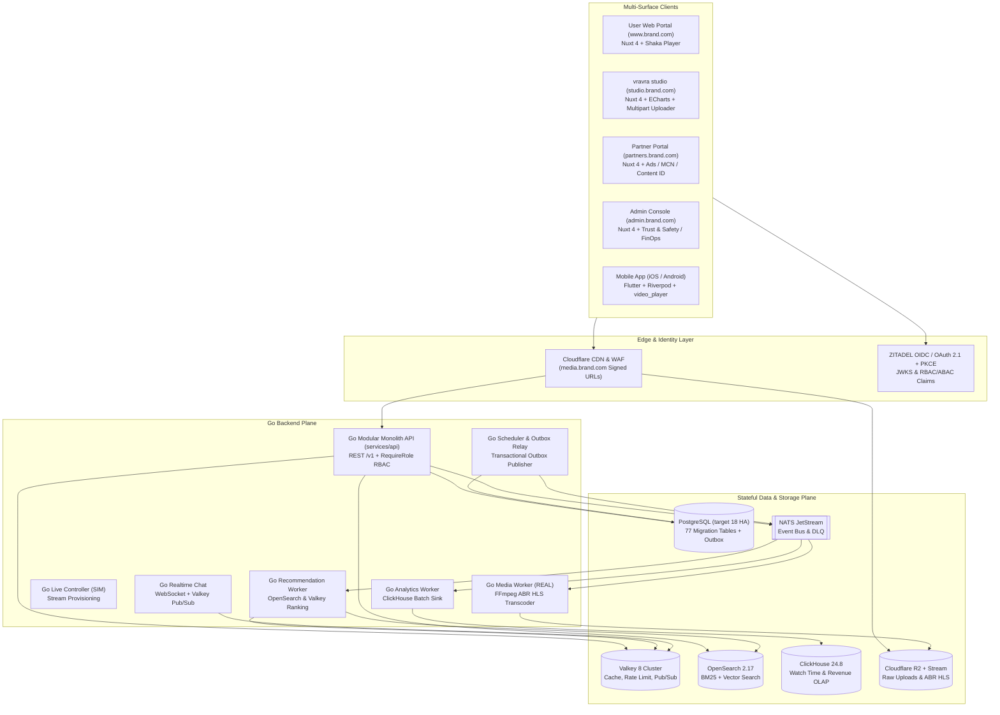
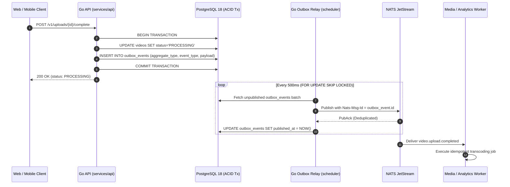

# vravra — System Architecture Specification (Phase 0~7)

## 0. As-Built Operating Topology (2026-11-20, code-audited)

The diagram in §1 is the **target** architecture. The actually running topology is:

```text
browser -> console Workers (web/studio/partners/admin, /api)
       -> api-proxy Worker (API_UPSTREAM secret)
       -> cloudflared quick tunnel (*.trycloudflare.com, rotates on restart)
       -> gvp-api.exe :18092 + gvp-media-worker.exe :8081 (operator PC)
```

Port `8080` on the operator PC is occupied by another process and intentionally avoided.
The Go API serves from an **in-memory store first** with best-effort PostgreSQL
write-through for 7 kinds (users/channels/videos/series/hourly-views/media-jobs/transactions);
77 migration tables apply cleanly and misses never block serving.
Only `media-worker` is real (ffprobe/ffmpeg/shaka-packager over HTTP, 7-rung
ladder 240p–2160p); the other 5 workers are stdlib-only simulators.
No Go code connects to NATS, Valkey, OpenSearch, or ClickHouse yet; those
compose services are un-wired. HLS is served through the in-app gateway
(`GET /v1/hls/{videoID}/*`), not a media domain.
Authoritative current status: [docs/IMPLEMENTATION_STATUS.md](../IMPLEMENTATION_STATUS.md).

## 1. Executive Architecture Overview

The **vravra (GVP)** is a commercial-grade, multi-surface video ecosystem engineered around **4 independently deployed Nuxt 4 / Vue 3 web consoles**, a **Flutter iOS/Android mobile client**, and a **Go Modular Monolith API paired with 6 background workers** (1 real, 5 simulated — see §0).



---

## 2. Modular Monolith + Separated Workers Design

Rather than premature microservice fragmentation across dozens of synchronous RPC hops, GVP enforces a **Modular Monolith + Separated Workers** topology.
Status tags: **REAL** = wired and verified · **SIM** = in-memory simulator · **TARGET** = documented goal (§0 is the as-built record).

1. **`services/api` (Go Modular Monolith)** — **REAL**:
   - Serves all low-latency HTTP `/v1` REST traffic (no ConnectRPC; RBAC is `RequireRole` middleware, no Casbin dependency).
   - Internal domain boundaries (`internal/identity`, `internal/users`, `internal/channels`, `internal/videos`, `internal/uploads`, `internal/recommendations`, `internal/comments`, `internal/live`, `internal/studio`, `internal/partners`, `internal/ads`, `internal/copyright`, `internal/settlements`, `internal/moderation`, `internal/admin`, `internal/events`, `internal/series`) are Go packages over a memory-first store.
2. **`media-worker` (CPU-Isolated Transcoder)** — **REAL**:
   - Serves HTTP (`/jobs/transcode`, `/jobs/edit-render`, `/artifacts`), executing FFprobe validation, FFmpeg 7-rung ABR HLS ladder (`240p`–`2160p`), storyboard/poster generation, and ClearKey DRM packaging (dev flow). Dispatch is HTTP POST, not NATS. Spot-node placement is a target.
3. **`realtime-chat`** — **SIM**: in-memory `ChatHub` + HTTP intake only; no WebSocket server, no Valkey Pub/Sub. (The API itself hosts a real WS chat hub for live.)
4. **`analytics-worker`** — **SIM**: `FlushToClickHouse` appends to an in-memory slice (batch 500, manual flush); no ClickHouse INSERT.
5. **`recommendation-worker`** — **SIM/TARGET**: no OpenSearch/Valkey wiring; feeds are in-memory filters.
6. **`live-controller`** — **SIM**: "provisioning" assembles URL strings (no Cloudflare API calls); DVR is a string assignment with no recording path.
7. **`scheduler`** — **SIM**: outbox relay flips in-memory flags; no PG poll, no NATS publish, no timer loop. (The API never writes `outbox_events`, so there is nothing to relay yet.)

---

## 3. Transactional Outbox Pattern (TARGET — not wired)

> Target design. The API never inserts into `outbox_events` and the scheduler
> relay is an in-memory stub, so this sequence does not execute today.



---

## 4. S3-Compatible Multipart Upload & FFmpeg ABR HLS Pipeline (REAL)

1. **Upload Initiation (`POST /v1/uploads`)**:
   - Validates MIME type (`video/mp4`, `video/quicktime`, `video/webm`) and initializes an S3-compatible multipart upload with a 10 MB chunk size (works against R2/MinIO/SeaweedFS).
2. **Presigned Chunk Transfer (`POST /v1/uploads/{id}/parts`)**:
   - Returns short-lived presigned PUT URLs per `partNumber`; bytes flow client→object storage. A `local` relay mode (API-assembled bytes) coexists for non-S3 setups.
3. **Completion & FFprobe Verification (`POST /v1/uploads/{id}/complete`)**:
   - Verifies part ETags, finalizes the object, and dispatches an HTTP transcode job to `media-worker`.
4. **FFmpeg ABR Ladder & Packaging (REAL, E2E green)**:
   - Generates 7-rung HLS (`240p`–`2160p`), master playlist, posters, storyboards, and ClearKey CENC packages (dev DRM flow), published to the HLS bucket and served through the in-app gateway. `media.brand.com` edge delivery is a target.

---

## 5. Valid View Pipeline (REAL) & ClickHouse Sink (TARGET)

- **Ingest (REAL)**: `POST /v1/events/analytics` accepts heartbeats and bumps in-memory view counts.
- **Deduplication (REAL)**: 24h viewer·video dedup with a single counting path, persisted to PG (P1-14).
- **Warehouse sink (TARGET)**: Valkey buckets + ClickHouse `ReplacingMergeTree` batching are not wired; the analytics worker only appends to memory.
