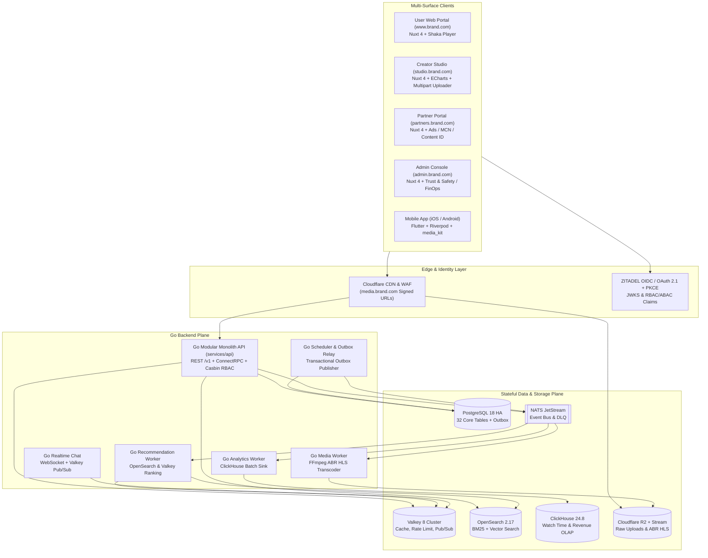
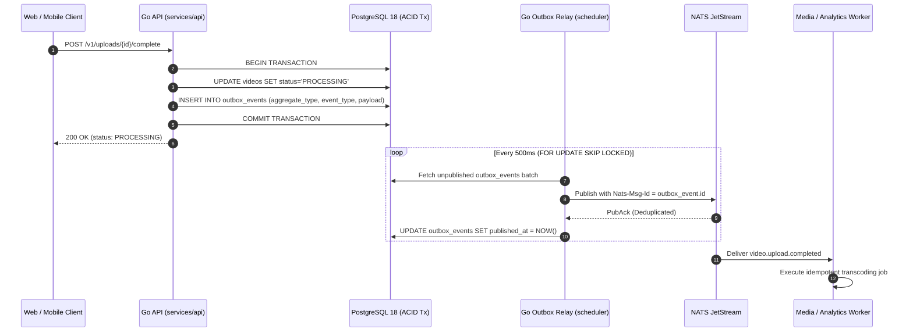

# Global Video Platform — System Architecture Specification (Phase 0~7)

## 1. Executive Architecture Overview

The **Global Video Platform (GVP)** is a commercial-grade, multi-surface video ecosystem engineered around **4 independently deployed Nuxt 4 / Vue 3 web consoles**, a **Flutter iOS/Android mobile client**, and a **Go Modular Monolith API paired with 5 horizontally scalable background workers**.

---

## 2. Modular Monolith + Separated Workers Design

Rather than premature microservice fragmentation across dozens of synchronous RPC hops, GVP enforces a **Modular Monolith + Separated Workers** topology:

1. **`services/api` (Go Modular Monolith)**:
   - Serves all low-latency HTTP `/v1` REST and ConnectRPC traffic.
   - Internal domain boundaries (`internal/identity`, `internal/users`, `internal/channels`, `internal/videos`, `internal/uploads`, `internal/recommendations`, `internal/comments`, `internal/live`, `internal/studio`, `internal/partners`, `internal/ads`, `internal/copyright`, `internal/settlements`, `internal/moderation`, `internal/admin`, `internal/events`) communicate via strict Go interfaces and shared database transactions.
2. **`media-worker` (CPU/GPU-Isolated Worker Pool)**:
   - Consumes `MEDIA_JOBS` from NATS JetStream on Spot/Preemptible compute nodes (`c7i.4xlarge`), executing FFprobe validation, FFmpeg multi-rung ABR HLS transcoding (`1080p`, `720p`, `480p`, `360p`), WebVTT sprite sheet generation, and loudnorm audio normalization.
3. **`realtime-chat` (Stateful WebSocket Gateway)**:
   - Manages high-concurrency live chat rooms, slow-mode rate limits, Super Chat pinned highlights, and Valkey Pub/Sub fanout.
4. **`analytics-worker` (High-Throughput OLAP Sink)**:
   - Buffers playback heartbeats (`valid_view`, `heartbeat`, `quality_change`, `ad_impression`) from NATS JetStream and flushes 5,000-row batches every 2 seconds into ClickHouse.
5. **`recommendation-worker` (Candidate & Ranking Pipeline)**:
   - Synchronizes video metadata and transcripts into OpenSearch and precomputes personalized home/shorts candidate feeds in Valkey.
6. **`scheduler` (Transactional Outbox Relay & Settlement Cron)**:
   - Polls `outbox_events` in PostgreSQL 18 every 500ms using `SELECT ... FOR UPDATE SKIP LOCKED`, publishes guaranteed-delivery messages to NATS JetStream, and triggers monthly partner/creator ledger settlements.

---

## 3. Transactional Outbox Pattern (Zero Dual-Write Loss)

---

## 4. Direct R2 Multipart Upload & FFmpeg ABR HLS Pipeline

1. **Upload Initiation (`POST /v1/uploads`)**:
   - Validates creator quota, MIME type (`video/mp4`, `video/quicktime`, `video/webm`), and initializes an S3/R2 multipart upload in bucket `gvp-raw-uploads` with a 10 MB chunk size.
2. **Direct Browser/Mobile-to-R2 Chunk Transfer (`POST /v1/uploads/{id}/parts`)**:
   - Returns short-lived presigned PUT URLs per `partNumber`. Video bytes flow directly from the client to Cloudflare R2 without saturating Go API memory or bandwidth.
3. **Completion & FFprobe Verification (`POST /v1/uploads/{id}/complete`)**:
   - Verifies part ETags, finalizes the R2 object, and dispatches `video.upload.completed` to `media-worker`.
4. **FFmpeg ABR Ladder & Packaging**:
   - Generates fMP4/TS HLS segments (`4s` GOP-aligned keyframes), master playlist (`master.m3u8`), thumbnail VTT sprites, and AES-128 / Widevine / FairPlay key manifests in `gvp-public-hls`, served globally via `media.brand.com`.

---

## 5. ClickHouse Real-Time Analytics & Valid View Pipeline

- **Client Heartbeats (`POST /v1/events/analytics`)**: Dispatched every 15 seconds during active playback with `event_id`, `session_id`, `video_id`, `watch_duration_seconds`, and `current_position_seconds`.
- **Anti-Fraud & Deduplication**: Deduplicated by `(session_id, video_id, time_bucket)` in Valkey + ClickHouse `ReplacingMergeTree`, enforcing a minimum continuous watch threshold before incrementing `valid_view` counters and creator revenue attribution.
