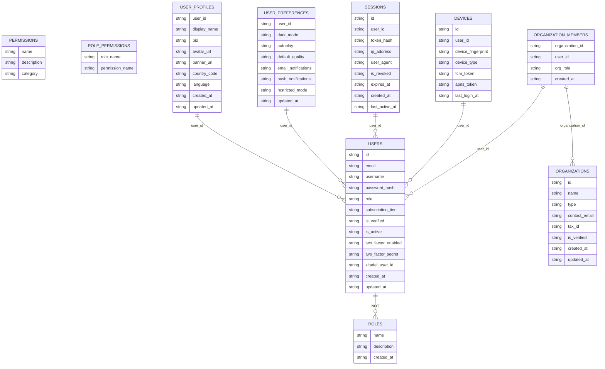

# 00001_create_accounts — Identity, RBAC, Sessions, Organizations

Source: `db/migrations/00001_create_accounts.sql`. Tables: **10**. Foreign keys: **7**.

Regenerated by `python docs/generate_erd.py`. Do not hand-edit.

## Tables

- `roles` (3 columns)
- `permissions` (3 columns)
- `role_permissions` (2 columns)
- `users` (13 columns)
- `user_profiles` (9 columns)
- `user_preferences` (8 columns)
- `sessions` (9 columns)
- `devices` (7 columns)
- `organizations` (8 columns)
- `organization_members` (4 columns)

## Diagram

