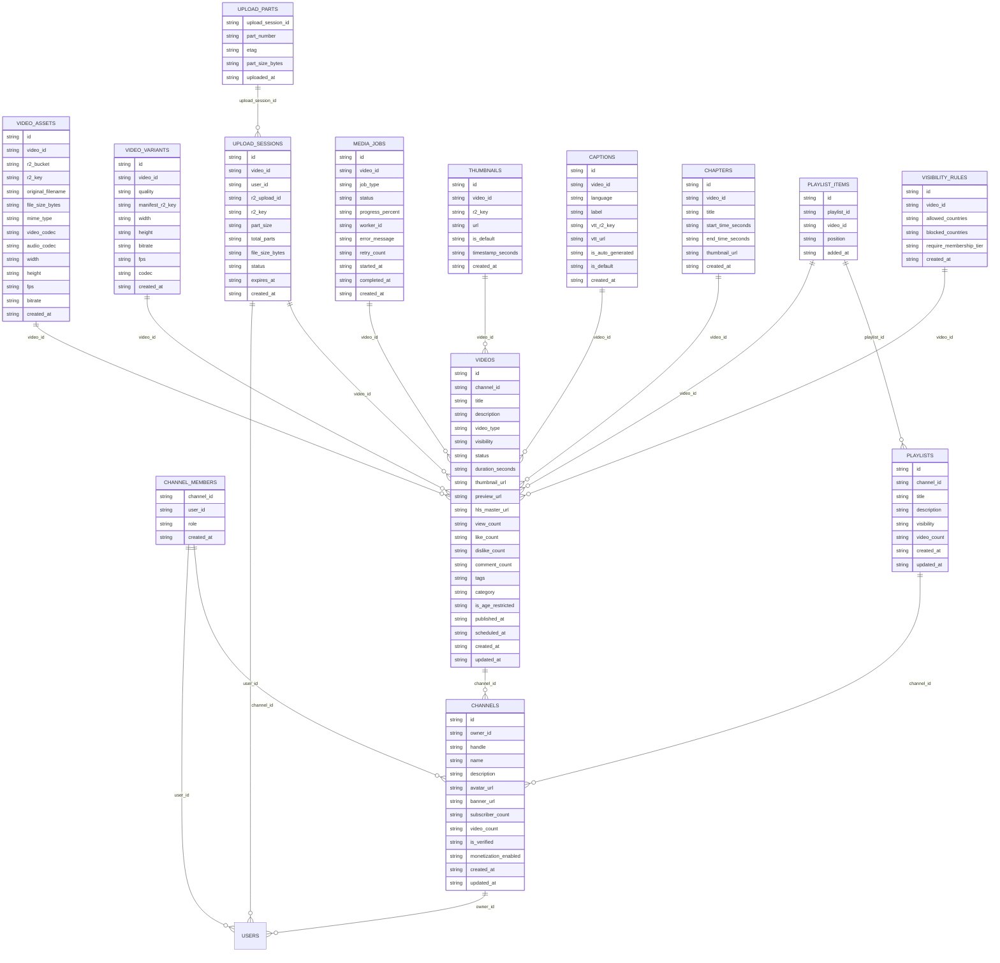

# 00002_create_content — Catalog, Channels, Videos, Media Ingest

Source: `db/migrations/00002_create_content.sql`. Tables: **14**. Foreign keys: **17**.

Regenerated by `python docs/generate_erd.py`. Do not hand-edit.

## Tables

- `channels` (13 columns)
- `channel_members` (4 columns)
- `videos` (22 columns)
- `video_assets` (14 columns)
- `video_variants` (10 columns)
- `upload_sessions` (11 columns)
- `upload_parts` (5 columns)
- `media_jobs` (11 columns)
- `thumbnails` (7 columns)
- `captions` (9 columns)
- `chapters` (7 columns)
- `playlists` (8 columns)
- `playlist_items` (5 columns)
- `visibility_rules` (6 columns)

## Diagram

