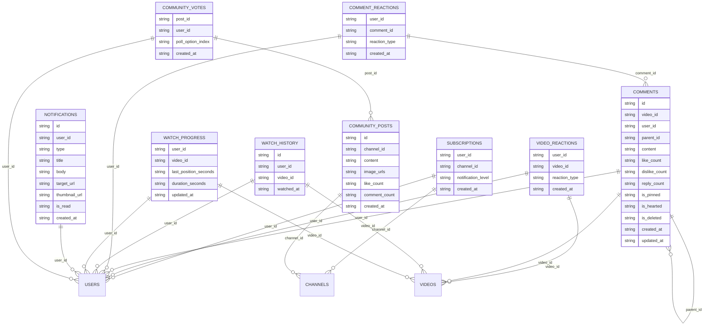

# 00003_create_social — Engagement: Reactions, Comments, History, Community

Source: `db/migrations/00003_create_social.sql`. Tables: **9**. Foreign keys: **17**.

Regenerated by `python docs/generate_erd.py`. Do not hand-edit.

## Tables

- `subscriptions` (4 columns)
- `video_reactions` (4 columns)
- `comments` (13 columns)
- `comment_reactions` (4 columns)
- `watch_history` (4 columns)
- `watch_progress` (5 columns)
- `notifications` (9 columns)
- `community_posts` (7 columns)
- `community_votes` (4 columns)

## Diagram

