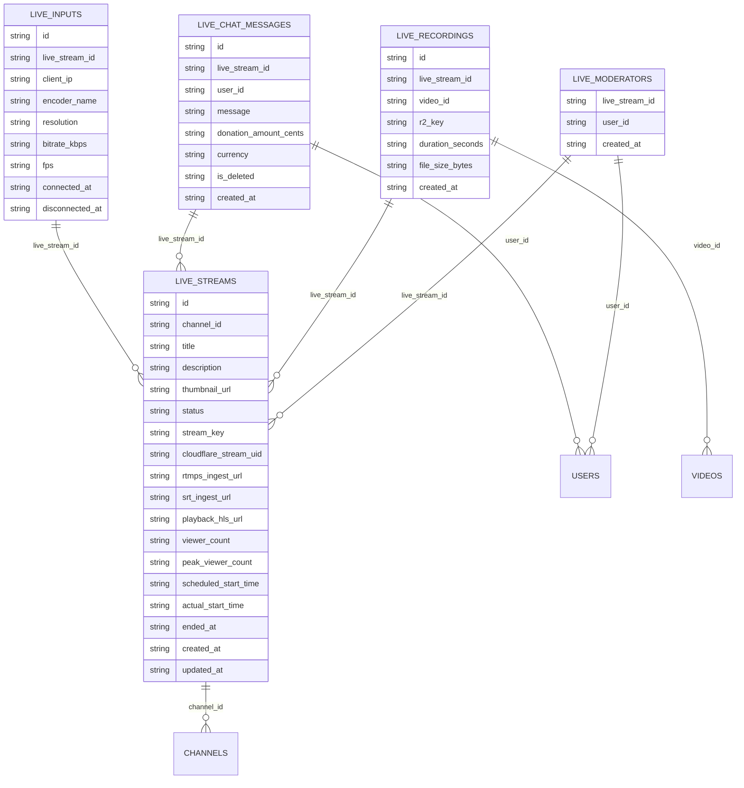

# 00004_create_live — Live Streams, Inputs, Chat, Recordings

Source: `db/migrations/00004_create_live.sql`. Tables: **5**. Foreign keys: **8**.

Regenerated by `python docs/generate_erd.py`. Do not hand-edit.

## Tables

- `live_streams` (18 columns)
- `live_inputs` (9 columns)
- `live_chat_messages` (8 columns)
- `live_recordings` (7 columns)
- `live_moderators` (3 columns)

## Diagram

