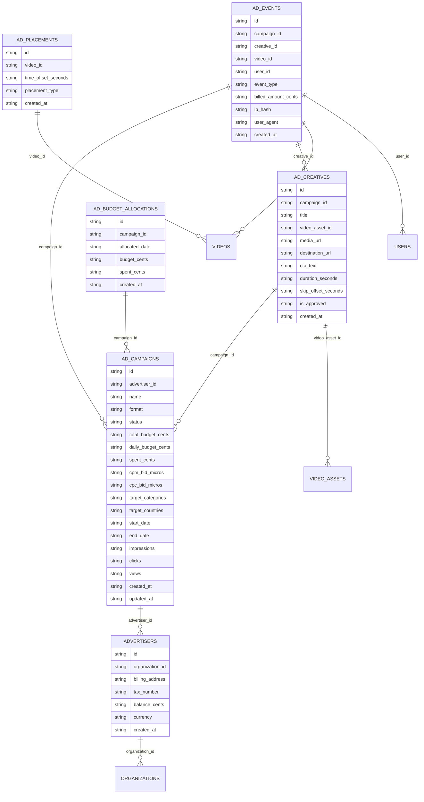

# 00005_create_ads — Base Advertising: Campaigns, Creatives, Placements

Source: `db/migrations/00005_create_ads.sql`. Tables: **6**. Foreign keys: **10**.

Regenerated by `python docs/generate_erd.py`. Do not hand-edit.

## Tables

- `advertisers` (7 columns)
- `ad_campaigns` (19 columns)
- `ad_creatives` (11 columns)
- `ad_placements` (5 columns)
- `ad_events` (10 columns)
- `ad_budget_allocations` (6 columns)

## Diagram

