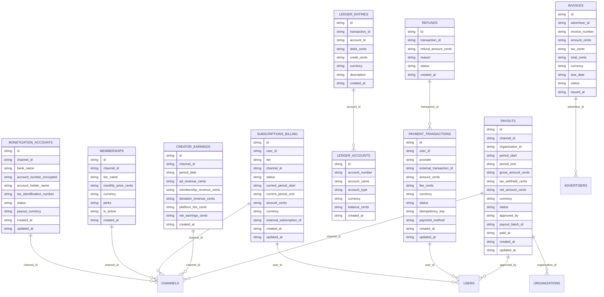

# 00006_create_payments_and_ledger — Monetization, Payments, Double-Entry Ledger

Source: `db/migrations/00006_create_payments_and_ledger.sql`. Tables: **10**. Foreign keys: **12**.

Regenerated by `python docs/generate_erd.py`. Do not hand-edit.

## Tables

- `monetization_accounts` (10 columns)
- `memberships` (8 columns)
- `subscriptions_billing` (12 columns)
- `payment_transactions` (12 columns)
- `refunds` (6 columns)
- `ledger_accounts` (7 columns)
- `ledger_entries` (8 columns)
- `creator_earnings` (9 columns)
- `payouts` (15 columns)
- `invoices` (10 columns)

## Diagram

