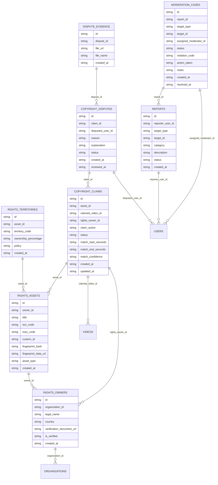

# 00007_create_copyright_and_moderation — Rights, Copyright Claims, Moderation

Source: `db/migrations/00007_create_copyright_and_moderation.sql`. Tables: **8**. Foreign keys: **12**.

Regenerated by `python docs/generate_erd.py`. Do not hand-edit.

## Tables

- `rights_owners` (7 columns)
- `rights_assets` (10 columns)
- `rights_territories` (6 columns)
- `copyright_claims` (11 columns)
- `copyright_disputes` (8 columns)
- `dispute_evidence` (5 columns)
- `reports` (8 columns)
- `moderation_cases` (11 columns)

## Diagram

