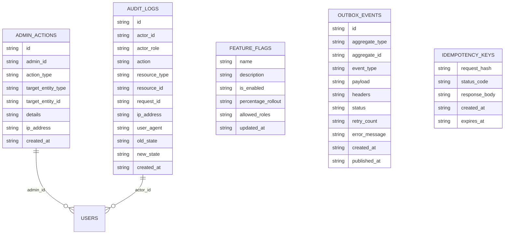

# 00008_create_operations_and_outbox — Admin Ops, Audit, Feature Flags, Outbox

Source: `db/migrations/00008_create_operations_and_outbox.sql`. Tables: **5**. Foreign keys: **2**.

Regenerated by `python docs/generate_erd.py`. Do not hand-edit.

## Tables

- `admin_actions` (8 columns)
- `audit_logs` (12 columns)
- `feature_flags` (6 columns)
- `outbox_events` (11 columns)
- `idempotency_keys` (5 columns)

## Diagram

