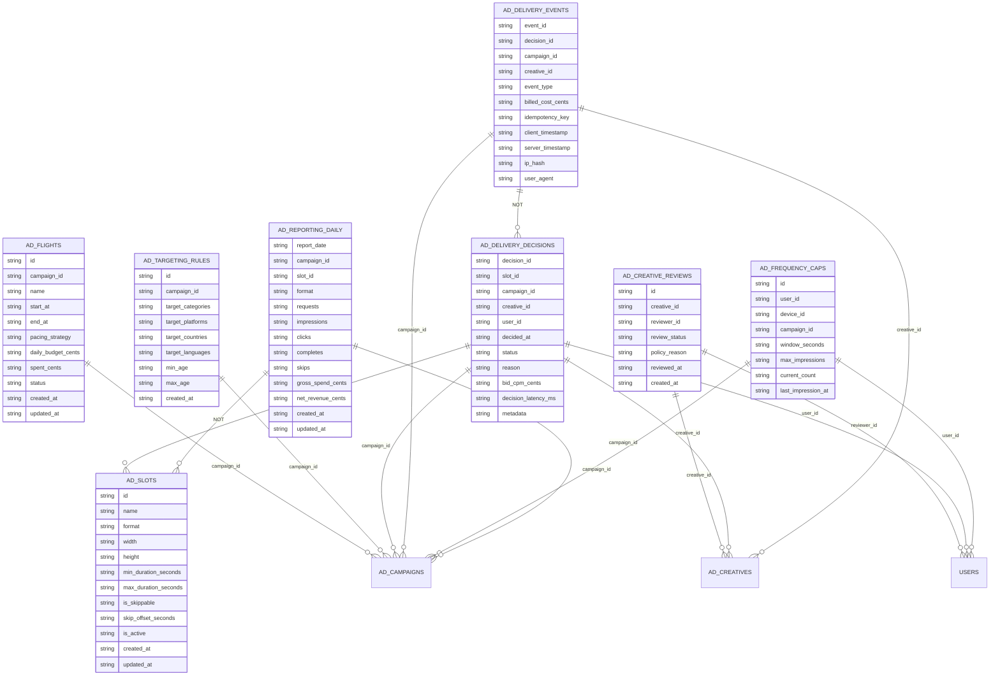

# 00009_create_production_ad_engine — Production Ad Engine: Slots, Flights, Delivery

Source: `db/migrations/00009_create_production_ad_engine.sql`. Tables: **8**. Foreign keys: **15**.

Regenerated by `python docs/generate_erd.py`. Do not hand-edit.

## Tables

- `ad_slots` (12 columns)
- `ad_flights` (11 columns)
- `ad_targeting_rules` (9 columns)
- `ad_creative_reviews` (7 columns)
- `ad_delivery_decisions` (11 columns)
- `ad_delivery_events` (11 columns)
- `ad_frequency_caps` (8 columns)
- `ad_reporting_daily` (13 columns)

## Diagram

