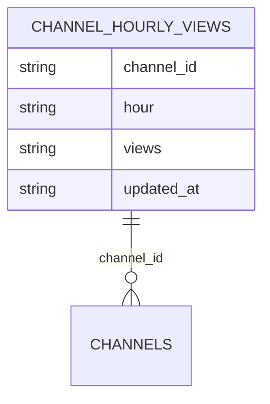

# 00012_vravra_studio_completion — Studio Completion: Hourly Views + Video Columns

Source: `db/migrations/00012_vravra_studio_completion.sql`. Tables: **1**. Foreign keys: **1**.

Regenerated by `python docs/generate_erd.py`. Do not hand-edit.

## Alters (added columns)

- `videos`: `custom_thumbnail_url`, `auto_frame_urls`, `elements`

## Tables

- `channel_hourly_views` (4 columns)

## Diagram

