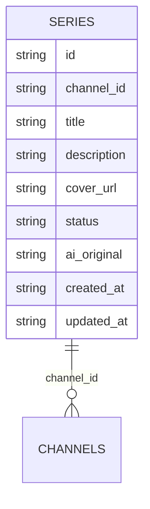

# 00014_ai_originals — AI Originals: Series + AI Review Columns

Source: `db/migrations/00014_ai_originals.sql`. Tables: **1**. Foreign keys: **1**.

Regenerated by `python docs/generate_erd.py`. Do not hand-edit.

## Alters (added columns)

- `videos`: `ai_generated`, `ai_tool`, `ai_review_status`, `ai_review_note`, `series_id`, `season_no`, `episode_no`

## Tables

- `series` (9 columns)

## Diagram

